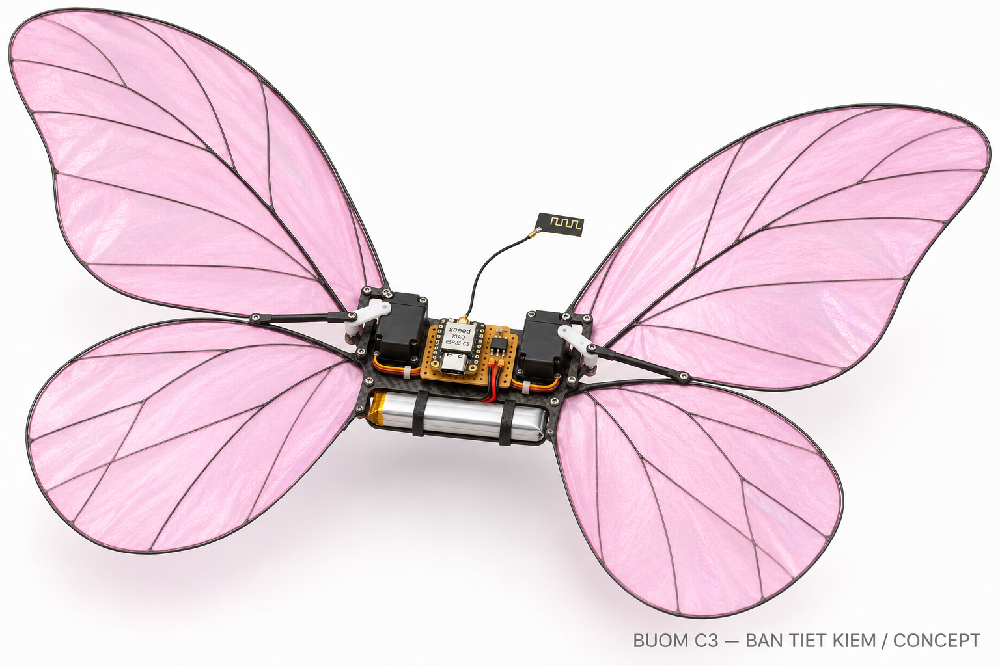

# Bướm C3 ECO

Hồ sơ prototype bướm vỗ cánh điều khiển tay bằng **XIAO ESP32-C3 + ESP-NOW**. Dự toán **3.865.000 đồng** gồm bướm, tay phát tự ráp, bộ sạc, nguồn cho sạc và 400.000 đồng dự phòng; chưa gồm dụng cụ hàn/đo. Giá và khối lượng là dự toán tại thời điểm lập hồ sơ ngày 12/11/2026.

**Chưa thử bay trên phần cứng thật.** Mạch, firmware và mô phỏng đã được kiểm tra ở mức được ghi trong báo cáo; khả năng nâng và bay cần đo trên mẫu chế tạo. Bản ECO không có IMU; PID và bám đường trong mô phỏng là phần nghiên cứu nâng cấp.

## Tải và bắt đầu

- [Tải toàn bộ hồ sơ ZIP](outputs/Buom_C3_ECO_duoi_4_trieu.zip?raw=true)
- [Hướng dẫn chế tạo PDF — 9 trang](outputs/buom_c3_eco/HUONG_DAN_CHE_TAO.pdf)
- [BOM Excel](outputs/buom_c3_eco/BOM_Buom_C3.xlsx) · [BOM CSV](outputs/buom_c3_eco/BOM.csv)
- [Đọc trước khi mua linh kiện](outputs/buom_c3_eco/README.md)
- [Báo cáo kiểm tra và giới hạn](outputs/buom_c3_eco/verification/FINAL_CHECKS.md)



## Nội dung

| Thư mục | Nội dung |
|---|---|
| [hardware](outputs/buom_c3_eco/hardware) | Schematic, PCB KiCad 10, PDF, Gerber và Excellon; carrier PCB là tùy chọn |
| [firmware_eco](outputs/buom_c3_eco/firmware_eco) | Mã Arduino cho bướm XIAO ESP32-C3 và tay phát ESP32 DevKit |
| [pid_reference](outputs/buom_c3_eco/pid_reference) | PID thuần C++ tham khảo cho nghiên cứu nâng cấp |
| [matlab](outputs/buom_c3_eco/matlab) | Mô hình MATLAB, bốn kịch bản đã chạy bằng Octave và dữ liệu kết quả |
| [viewer](outputs/buom_c3_eco/viewer) | Trình xem Three.js/WebGL 3D, thư viện đi kèm để chạy cục bộ |
| [images](outputs/buom_c3_eco/images) | Ảnh concept, sơ đồ đấu dây và ảnh xem trước |
| [verification](outputs/buom_c3_eco/verification) | Log compile, ERC/DRC, kiểm tra netlist, PID/protocol và viewer |

Firmware giao mặc định khóa actuator. Đọc hướng dẫn để điền MAC, đổi khóa ghép đôi mẫu, hiệu chuẩn nguồn/xung–góc, kiểm tra chiều servo và mất link trước khi lắp cánh.

## Chạy mô phỏng và xem 3D

Trong MATLAB, chuyển vào thư mục `outputs/buom_c3_eco/matlab` rồi chạy `run_all`. Mã không cần toolbox; kết quả đi kèm được chạy trên **GNU Octave 11.3.0**, chưa chạy trực tiếp bằng MATLAB. Hệ số khí động đang là giả định; mô hình có thông tin vị trí/độ cao lý tưởng mà phần cứng ECO không có.

Với Python 3, chạy từ thư mục gốc repo:

```sh
python outputs/buom_c3_eco/start_viewer.py
```

Trình xem tự mở tại `http://127.0.0.1:8765/viewer/`, animation tự chạy. Đây là phát lại dữ liệu mô phỏng; không phải bằng chứng mẫu thật có thể bay theo đường đó.

## Kiểm tra đã thực hiện

KiCad ERC 0 lỗi/0 cảnh báo; DRC 0 vi phạm và 0 pad chưa nối theo cấu hình kiểm tra đi kèm; đối chiếu 89 chân giữa schematic và PCB. Hai firmware đã biên dịch với Arduino-ESP32 3.3.3. Kiểm tra C++ điều khiển/protocol, bốn kịch bản Octave và viewer Edge/WebGL2 đã chạy. Các mục bỏ qua trong ERC/DRC được giữ trong file báo cáo.

[SHA256SUMS.txt](outputs/buom_c3_eco/SHA256SUMS.txt) ghi hash các file bàn giao, với đường dẫn tính từ `outputs/buom_c3_eco/`. ZIP đã được kiểm tra CRC và đối chiếu nội dung với bản thư mục.

## Nguồn cơ khí và giấy phép

Tham khảo hình học [ESP-FLUTTER của Max Imagination](https://github.com/maximagination1/ESP-FLUTTER). **File cơ khí STL có phí không nằm trong repo**; mua từ tác giả theo link trong hướng dẫn. Khoản dự toán file/in đã có trong BOM. Repo không phân phối firmware gốc của dự án tham khảo.

Xem [THIRD_PARTY.md](outputs/buom_c3_eco/THIRD_PARTY.md) và các thông báo giấy phép đi kèm cho KiCad Libraries và Three.js. Chỉ hồ sơ bàn giao và mã nguồn dự án được đưa lên đây; bộ cài, cache và file làm việc tạm không thuộc gói.
