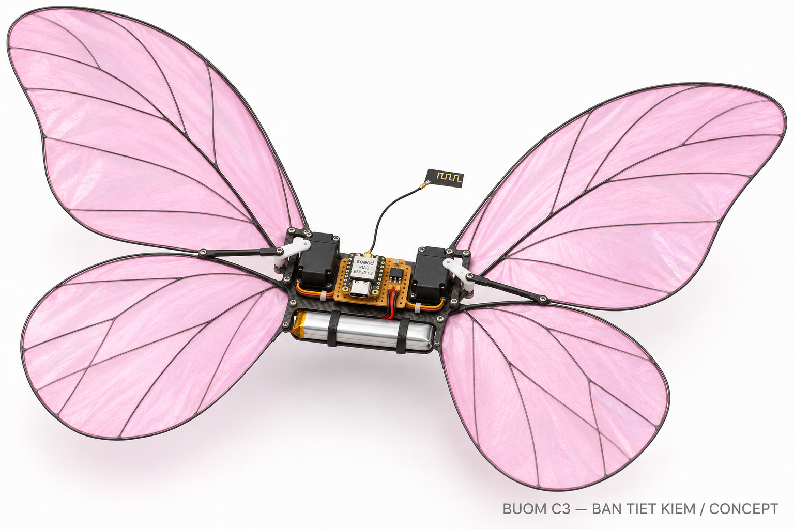
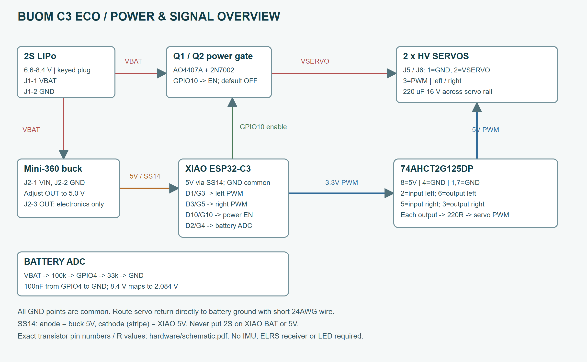
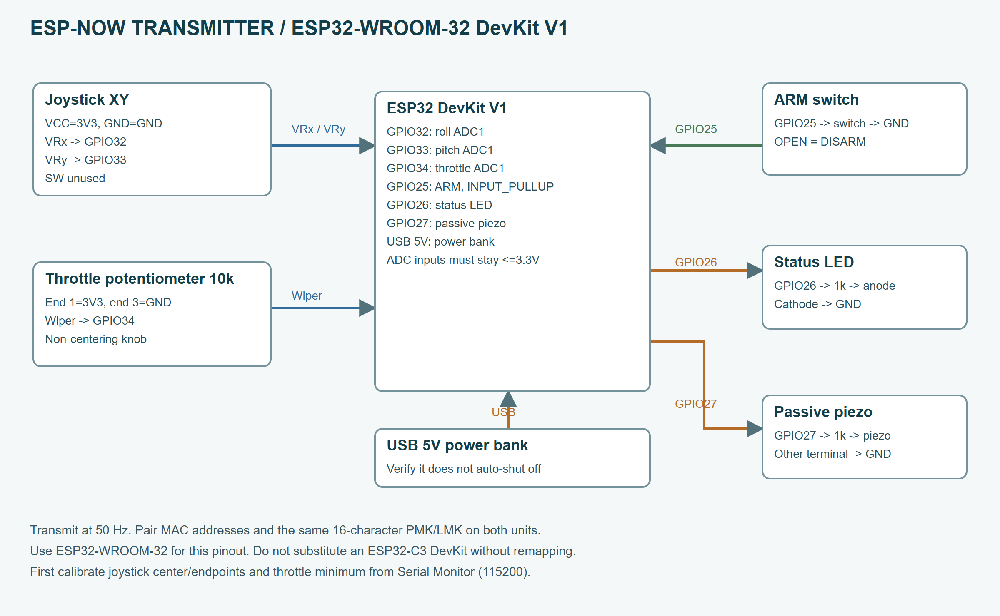
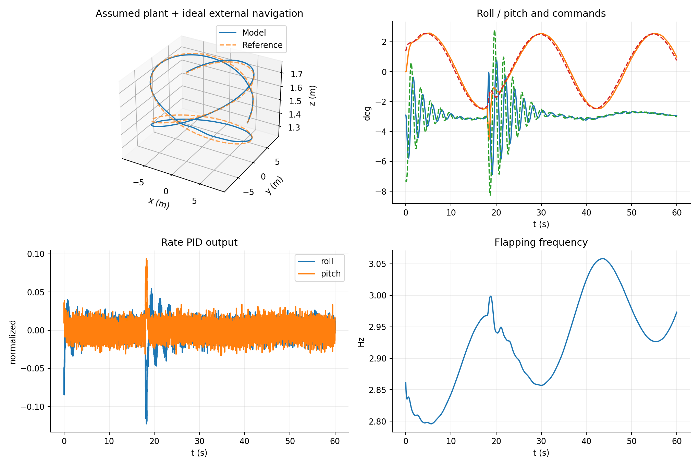

# Bướm C3 - bản tiết kiệm dưới 4 triệu

Hồ sơ prototype, cập nhật 12/11/2026. Bản chính: hai servo vỗ cánh, ESP32-C3 nhận ESP-NOW, người lái điều khiển trực tiếp. Không IMU, ELRS, LED, tải nhẫn hoặc tự động giữ vị trí.

**Ngân sách dự toán: 3.865.000 đồng**, đã gồm bướm, tay phát tự ráp, sạc và 400.000 đồng dự phòng. Chưa gồm dụng cụ hàn/đo; giá và tồn kho phải xác nhận trước đặt. Đây chưa phải sản phẩm đã bay thử: code và CAD được kiểm tra bằng phần mềm; lực nâng, thời gian bay, độ bền cánh và thông số servo dưới tải chưa đo.

## 1. Chốt cấu hình và tiền mua

| Nhóm | Dự toán VND | Nội dung |
|---|---:|---|
| Điện tử trên bướm | 1.810.000 | XIAO, hai SDS1601 HV, pin 2S, buck, mạch nguồn/PWM |
| Cánh và cơ khí | 640.000 | Carbon, màng, file/khung in, horn, vít, dây/keo |
| Tay phát ESP-NOW | 355.000 | ESP32 DevKit, joystick, ga, công tắc, hộp, nguồn USB |
| Sạc và phụ kiện | 660.000 | Sạc balance 2S, nguồn DC phù hợp, dây và túi sạc |
| Dự phòng | 400.000 | Vận chuyển, linh kiện hỏng hoặc dịch vụ hàn |
| Tổng | 3.865.000 | Còn 135.000 đồng so với trần 4 triệu |

Mở **BOM_Buom_C3.xlsx**, sửa đơn giá theo báo giá thực; cột thành tiền và dư địa tự tính. Giá 650.000 đồng/servo là mức dự toán để đặt hàng, không phải báo giá đã xác nhận. Nếu hai servo vượt mức này, điều chỉnh nguồn mua và tổng tiền trước mua các món còn lại. Servo và bộ cơ khí khớp servo là hai món cần chốt đầu tiên.

Mẫu cơ khí tham khảo là ESP-FLUTTER của Max Imagination, một bướm hai servo dùng ESP32-C3 và pin 2S đã được tác giả trình diễn. Video TikTok không cung cấp đủ kích thước, mã linh kiện hoặc firmware để sao chép chính xác sản phẩm trong video. Bộ này là phương án prototype dựa trên kiến trúc tương tự.

<!-- page -->
## 2. Linh kiện nào phải đúng thông số

- **Servo:** hai SDS1601 loại HV 180 độ theo cấu hình ESP-FLUTTER, có horn gốc. Xác nhận với người bán khả năng dùng trực tiếp pin 2S đầy 8,4 V và tốc độ công bố khoảng 0,08 s/60 độ. Tốc độ không tải không chứng minh tốc độ khi gắn cánh. Không thay bằng SG90/MG90S chỉ vì rẻ hơn; không thay servo 360 độ quay liên tục.
- **Pin:** LiPo 2S 220 mAh, ưu tiên nhẹ, dòng xả công bố từ 45C; xác nhận giắc và cực. 45C x 0,22 Ah = 9,9 A là giá trị nhãn, vẫn phải đo sụt áp. Chỉ mua một pin đợt đầu.
- **Buck Mini-360:** module MP2307 chỉnh ra 5,0 V trước lắp; kiểm tra đúng chip/module thực mua. Cấp điện tử, không cấp nguồn động lực cho hai servo. Đo tải 0,5 A để loại module kém chất lượng.
- **Mạch đệm:** đúng 74AHCT2G125DP, TSSOP8. AHCT có ngưỡng vào TTL phù hợp tín hiệu 3,3 V khi cấp 5 V. Không tráo pin theo loại 125 khác; bảng chân U2 đã đối chiếu datasheet.
- **Cánh:** carbon 1 và 1,5 mm, màng PE rất mỏng. Mục tiêu hai bên cánh hoàn chỉnh khoảng 16 g, gồm gân và keo. Khối lượng cuối phải cân, không suy ra từ diện tích màng.
- **Sạc:** hỗ trợ balance LiPo 2S, chỉnh dòng khoảng 0,2 A. 1C của pin 220 mAh là 0,22 A; dùng giới hạn mà nhà sản xuất pin cho phép. TP4056 và mạch sạc 1S trên XIAO không sạc được pack 2S.

Ước tính bản bảng lỗ không tải là **77,5 g**: servo 32; cánh 16; khung/horn 5; pin 13; XIAO/anten 3,5; buck 2; mạch 2; dây/giắc/keo 4 g. Đây là ngân sách khối lượng, chưa cân thực. Dùng carrier PCB 60 x 40 mm có thể tăng khối lượng; cân lại toàn bộ. Nếu không đủ lực nâng, giảm khối lượng và sửa cánh/biên độ trước tăng pin lớn.

## 3. Hai cách lắp mạch

**Bản tiết kiệm:** bảng lỗ nhỏ hoặc hàn dây theo netlist và schematic, đặt sát nhau để nhẹ. U2 cần adapter TSSOP8 nếu không dùng PCB. Giữ mạch đóng/cắt nguồn servo Q1/Q2 và tụ lọc. Bỏ J3, J4, J7, Q3, R7, R8; đó là đầu nối IMU/ELRS/LED của phương án mở rộng. Không mua những module này.

**PCB tùy chọn:** thư mục hardware có file KiCad sửa được, PDF schematic và Gerber/drill. PCB 60 x 40 mm, hai lớp, FR4 0,8 mm, đồng 1 oz; đường VBAT/VSERVO tối thiểu 1 mm và hai mặt đổ GND. Đây là carrier chứa linh kiện rời; Mini-360 và XIAO vẫn là module. PCB chưa được đo nhiệt/dòng thật. Nếu đặt mạch, dùng khoản dự phòng và kiểm tra báo giá để giữ tổng dưới 4 triệu.

Không hàn thêm U1 vào tiền A05: U1 đã nằm ở A01 của BOM. Chân BAT dưới XIAO để hở; footprint carrier đã bỏ các pad đáy không dùng. Dùng pad số vuông để nhận diện pin 1 của header; bảng chân là căn cứ, không căn theo màu dây servo.

<!-- page -->
## 4. Đấu điện trên bướm

| Điểm | Kết nối |
|---|---|
| J1-1 / J1-2 | Pin 2S dương VBAT / âm GND |
| J2-1 / 2 / 3 | VIN buck / GND buck / OUT buck 5 V |
| J5-1 / 2 / 3 | Servo trái GND / VSERVO / PWM |
| J6-1 / 2 / 3 | Servo phải GND / VSERVO / PWM |
| XIAO D1 / GPIO3 | PWM trái vào U2 pin 2; U2 pin 6 qua R9 220 ohm tới J5-3 |
| XIAO D3 / GPIO5 | PWM phải vào U2 pin 5; U2 pin 3 qua R10 220 ohm tới J6-3 |
| U2 pin 8 / 4 | 5 V / GND; pin 1 và 7 nối GND; C3 100 nF đặt gần chân nguồn |
| XIAO D10 / GPIO10 | Qua R5 100 ohm tới gate Q2, điều khiển đóng nguồn servo |
| XIAO D2 / GPIO4 | Điểm giữa R1 100k và R2 33k đo pin; C1 100 nF xuống GND |
| XIAO 5V / GND | 5 V qua D1 SS14 / GND chung; không nhận trực tiếp 2S |

Q1 AO4407A: chân 1/2/3 là source nối VBAT, chân 5/6/7/8 drain nối VSERVO, chân 4 gate. R3 100k kéo gate về VBAT để tắt mặc định. Q2 2N7002: pin 1 gate, 2 source GND, 3 drain qua R4 10k tới gate Q1. R6 100k kéo gate Q2 xuống GND. Với bố trí này reset MCU làm rail servo tắt. D1: anode nhận 5 V buck, cathode có vạch đi tới XIAO 5V. C5 220 uF/16 V: cực dương vào VSERVO, âm vào GND.

ADC: Vpin = Vadc x (100+33)/33 x VBAT_CAL. Với pin 8,4 V, nút ADC lý tưởng 2,084 V. Hiệu chuẩn VBAT_CAL bằng đồng hồ khi servo chưa chạy, rồi kiểm tra lại khi chạy. Không dùng sai tỷ số điện trở của mạch tham khảo khác.

Nguồn servo và điện tử cùng GND nhưng đi dây nguồn servo ngắn 24AWG về gần cực âm pin; tránh cho dòng servo chạy qua dây GND mỏng của XIAO. Bảng lỗ dùng dây đồng nối nguồn, không chỉ dựa vào giọt thiếc mảnh. Mạch không có bảo vệ ngược cực: dùng giắc có khóa và đo cực trước lần cấp điện đầu.

<!-- page -->
## 5. Tay điều khiển tự ráp

| ESP32 DevKit V1 | Đấu nối |
|---|---|
| 3V3 / GND | Nguồn joystick và hai đầu biến trở ga 10k |
| GPIO32 | Joystick VRx, roll |
| GPIO33 | Joystick VRy, pitch |
| GPIO34 | Con chạy biến trở ga 10k |
| GPIO25 | Công tắc ARM xuống GND; mở là disarm |
| GPIO26 | Qua 1k tới anode LED báo, cathode về GND |
| GPIO27 | Qua 1k tới piezo thụ động; chân còn lại GND |
| USB | Power bank 5 V cho tay phát |

Chỉ dùng joystick với ngõ ra tối đa 3,3 V. GPIO32/33/34 đều là ADC1 của ESP32 WROOM nên dùng cùng Wi-Fi. Không thay board tay phát bằng ESP32-C3 và giữ nguyên sơ đồ chân này. Các chân SW trên joystick không dùng.

Ga dùng núm không tự hồi; đầu ga thấp phải ra gần 0%. Cần gạt roll/pitch có vùng chết 6%. Firmware gửi 50 gói/giây, máy bay xử lý ở khoảng 200 Hz. ESP-NOW unicast có mã hóa, khóa và MAC phải khớp hai bên. Không có ứng dụng điện thoại bắt buộc.

LED tay phát sáng liên tục khi bướm báo armed, chớp chậm khi có link nhưng disarm. Piezo kêu ngắt quãng khi pin báo dưới 7,0 V hoặc mất telemetry trong khi công tắc ARM đang bật. Đây là cảnh báo để người lái hạ cánh; không tự hạ cánh hay tự định vị.

## 6. Lắp cơ khí theo mẫu cơ sở

Mua/in bộ khung và bản cánh ESP-FLUTTER ở nguồn tác giả cuối tài liệu. File STL thương mại không nằm trong gói này; BOM đã dành 250.000 đồng cho file và in nhẹ, cần xác nhận báo giá. Giữ đúng tỷ lệ in 100%, kiểm tra kích thước chuẩn trên bản vẽ trước cắt. Nếu thuê in, yêu cầu bộ dành cho đúng servo SDS1601 và dùng horn đi kèm servo. Không in tự chế spline gắn trục servo.

Trình tự: làm một bên cánh theo template; cân; làm bên còn lại đối xứng; cân và chỉnh lệch khối lượng càng nhỏ càng tốt (mục tiêu dưới 0,2 g). Dán màng vừa đủ phẳng, không căng đến mức xoắn gân. Lắp servo chắc vào khung, đặt tín hiệu 1500 us khi chưa gắn horn, rồi gắn horn ở vị trí trung tính cơ khí.

Pin buộc dưới thân, gần trọng tâm; cho phép trượt pin vài mm để chỉnh cân bằng. Không dùng ảnh AI để xác định hình học, tâm trục hay kích thước bản cắt. Không thêm khung trang trí, LED hoặc nhẫn ở lần bay đầu. Anten XIAO gắn đúng đầu nối, cách phần carbon và dây nguồn; không để vướng hành trình cánh.

<!-- page -->
## 7. Nạp firmware và kiểm tra trên bàn

Mã chính nằm trong firmware_eco/aircraft và firmware_eco/transmitter. Hai sketch đã biên dịch với Arduino-ESP32 3.3.3. Arduino IDE mở file .ino trong đúng thư mục; giữ config.h và protocol.h cùng thư mục.

1. Chọn board **XIAO_ESP32C3** cho bướm, **ESP32 Dev Module** cho tay phát. Nạp lần đầu khi chưa cắm servo. Mở Serial Monitor 115200 để lấy MAC mỗi máy.
2. Điền MAC tay phát vào TX_MAC của aircraft/config.h; MAC bướm vào AIR_MAC của transmitter/config.h. Hai máy dùng cùng channel 6. Thay hai khóa PMK/LMK bằng chuỗi đúng 16 ký tự ASCII giống nhau ở cả hai file protocol.h. Nạp lại.
3. Kiểm tra ga, roll, pitch bằng Serial tay phát. Đo giá trị raw ở hai đầu và giữa; sửa AXIS_MIN/CENTER/MAX và THR_MIN/MAX. Nếu hai trục có tâm khác nhau rõ rệt, sửa hàm axis để dùng bộ hiệu chuẩn riêng. Ga phải dưới 4% khi núm ở thấp nhất; công tắc mở phải arm=0.
4. Firmware giao mặc định RELEASE_ACTUATORS=false. Sau khi đo nguồn, kiểm tra cực và tháo cánh, đổi thành true rồi nạp lại. Giữ USE_POWER_SWITCH=true khi lắp Q1/Q2 đúng schematic.
5. ARM phải đi qua trạng thái tắt rồi bật, ga dưới 4%, pin trên 7,2 V và link đang mới. Máy chờ 0,5 giây ở giữa trước nhận ga, sau đó giới hạn tốc độ tăng ga. Khởi động với ARM bật không cho tự chạy.
6. Servo mặc định nhận PWM 50 Hz, tâm 1500 us và giới hạn 1100-1900 us. SIGN_L=+1, SIGN_R=-1 dành cho lắp đối xứng. Đo chiều thật với cánh tháo ra; hai cánh phải nâng/hạ cùng lúc trong hệ trục thân. Chỉnh tâm và giới hạn từng bên để không kẹt cơ khí. Không tăng refresh rate chỉ vì servo được gọi là digital.

Hiệu chuẩn cả US_PER_DEG: đo góc horn ở hai xung an toàn khi chưa lắp cánh, rồi đặt US_PER_DEG = (us_b - us_a)/(góc_b - góc_a). Giá trị mặc định 11,11 us/độ giả định 2000 us cho 180 độ; servo thực có thể dùng quy ước khác. Các con số góc dưới đây chỉ là góc thật sau khi hiệu chuẩn này đúng.

Trộn lệnh khi ga đủ: A trái = 25 + 6u_roll độ; A phải = 25 - 6u_roll độ; tâm chung = 5u_pitch độ. Góc cánh = A sin(phase) + tâm. Tần số từ 1,5 đến 3,8 Hz theo ga. Các dấu điều khiển cần kiểm tra trên cơ cấu thật; ROLL_SIGN/PITCH_SIGN là chỗ đổi dấu. Giới hạn tổng góc theo mặc định là 36 độ, vừa khớp khoảng xung đã chọn.

Tại f=3,8 Hz và A=31 độ, tốc độ đỉnh lý tưởng là 2*pi*f*A = 740 độ/s, gần tốc độ không tải 750 độ/s của servo tham khảo. Vì vậy bắt đầu thử ở 1,5-2 Hz, rồi 2,5-3 Hz; chỉ tiến tới cao hơn nếu servo vẫn theo kịp dưới tải. Hạ tần số/biên độ khi méo hành trình, nóng hoặc dòng tăng bất thường.

Mất gói mới quá 150 ms, lỗi lịch vòng lặp hoặc ARM tắt làm ngắt PWM và tắt rail servo. Muốn chạy lại phải đưa ARM về tắt rồi bật khi ga thấp. Mất điều khiển không tạo được hạ cánh tự động; bướm có thể rơi. Thử mất link khi giữ cố định trên bàn trước bay.

<!-- page -->
## 8. Nghiệm thu trước bay tự do

| Bước | Cách thử và điều kiện chuyển bước |
|---|---|
| 1 - Không cắm XIAO/servo | Kiểm tra chập VBAT-GND, chiều diode/MOSFET và tụ phân cực; chỉnh buck 5,0 V |
| 2 - Chỉ điện tử | Cấp 2S từ nguồn giới hạn dòng; kiểm tra 5 V, 3V3, ADC và không nóng bất thường |
| 3 - Servo không cánh | Tâm, biên, chiều; reset và mất link phải tắt VSERVO; không tự arm khi cấp pin |
| 4 - Có cánh, giữ cố định | Tăng f từng 0,25-0,5 Hz; ghi dòng trung bình/đỉnh, điện áp và nhiệt sau 30-60 s |
| 5 - Đo lực nâng | Đo lực trung bình nhiều chu kỳ bằng giá giữ và loadcell/cân có cơ cấu phù hợp; bù lực/khối lượng của gá |
| 6 - Tầm điều khiển | Thử ít nhất 20 m đường nhìn trong khu vực dự định bay; không mất link/reset khi servo hoạt động |
| 7 - Bay có dây giữ | Khu trống, dây không quấn cánh; bay thấp, ngắn; kiểm tra người lái có sửa được roll/pitch |
| 8 - Bay tự do ngắn | Chỉ chuyển khi các bước trước đạt; bắt đầu 10-20 s, không tải, không gần người |

Với khối lượng 77,5 g, trọng lượng khoảng **0,760 N**. Mục tiêu thử lực nâng trung bình tối thiểu 1,3 lần, khoảng **0,99 N**, là một ngưỡng sàng lọc cho prototype, không bảo đảm ổn định bay. Nếu chỉ đạt dưới trọng lượng, chưa thả bay; nếu vượt ngưỡng vẫn cần thử trim, tính điều khiển và độ bền. Đo lực trong tư thế/mặt phẳng vỗ phù hợp thiết kế, không lấy đỉnh lực một chu kỳ làm lực nâng trung bình.

Đo áp ngay tại rail servo và XIAO khi vỗ; XIAO không được reset. Tụ 220 uF không thay được pin/dây đủ dòng. Ví dụ tải tăng 2 A trong 1 ms trên 220 uF tạo độ sụt lý tưởng I*dt/C khoảng 9,1 V nếu chỉ tụ cấp dòng: pin và đường nguồn mới là nguồn chính.

Ghi tối thiểu: khối lượng; loại pin; điện áp không tải/có tải; f; biên độ thực; dòng trung bình/đỉnh; nhiệt servo; lực trung bình; thời gian thử; lỗi RF. Mẫu CSV measurement_log.csv có sẵn. Dừng thử nếu cánh chạm nhau, horn lỏng, cơ cấu kẹt, servo quá nóng theo giới hạn hãng, pin phồng hoặc sụt áp gây reset.

Thời gian bay chưa thể chốt từ mô phỏng. Ước lượng năng lượng: t_phút = 60 x 0,22 Ah x 0,8 / I_trung_bình. Nếu đo 2 A thì khoảng 5,3 phút về dung lượng; hao hụt, tải xung và giới hạn điện áp có thể làm ngắn hơn. Không coi đây là thông số bay đã kiểm chứng.

<!-- page -->
## 9. PID và mô phỏng để nâng cấp sau

Bản mua dưới 4 triệu không dùng PID ổn định vì chưa có IMU. Mã PID tham khảo và MATLAB được giữ để nghiên cứu bước sau. Để dùng thật phải thêm IMU, xác định dấu và độ nhạy điều khiển bằng đo, rồi hiệu chỉnh. Không nạp hệ số mô phỏng và coi như đã có bộ điều khiển bay ổn định.

Vòng ngoài: rate_ref = clip(3 x (angle_ref - angle), +/-1,2 rad/s). Vòng trong: u = Kp e + I - Kd d(rate_measured)/dt; đạo hàm lọc với tau=0,025 s, lấy trên đo lường để tránh giật khi đổi lệnh; tích phân có chặn +/-0,12 và dừng tích phân khi bão hòa cùng chiều sai số. Đầu ra chặn +/-0,35.

| Trục | Kp | Ki | Kd | Chức năng mixer |
|---|---:|---:|---:|---|
| Roll | 0,32 | 0,12 | 0,018 | Chênh biên độ hai cánh, tối đa +/-6 độ |
| Pitch | 0,38 | 0,14 | 0,020 | Dịch tâm vỗ chung, tối đa +/-5 độ |

Đơn vị: góc rad, tốc độ rad/s, thời gian s; Kp là u*s/rad, Ki là u/rad, Kd là u*s²/rad. Mô hình rate giả định p_dot = 30u - 4p và q_dot = 24u - 4q ở khối lượng danh định. Hệ số 30/24, lực nâng chuẩn, drag và lag servo là giả định để chạy nghiên cứu, chưa lấy từ mẫu thật.

Quy trình nhận dạng: giữ mẫu bằng gá cho phép xoay một trục; ghi gyro và lệnh với bước nhỏ u=+/-0,05, không để cánh kẹt. Fit p_dot = b*u - a*p bằng bình phương tối thiểu, kiểm tra dấu b; dùng tập dữ liệu khác để kiểm tra lại. Bắt đầu Ki=Kd=0 với Kp nhỏ, tăng từ từ trong thử có giữ; thêm Ki để sửa lệch tĩnh và D có lọc khi dữ liệu gyro đủ sạch. Gia tốc do vỗ cánh làm việc dùng accelerometer như phương thẳng đứng dễ sai; phải đánh giá cảm biến/fusion dưới tải thật.

Mô hình MATLAB có 13 trạng thái: vị trí, tốc độ tiến, heading, roll/pitch, hai tốc độ góc, tốc độ cao độ và ba trạng thái cơ cấu chấp hành. Tích phân RK4 ở 0,004 s; lệnh giữ theo mẫu, lag servo 55 ms, giới hạn tốc độ, gió, nhiễu đo, sụt pin và một xung nhiễu tại 18 s. Đây là mô hình trung bình bậc giảm, không phải CFD hoặc mô hình 6-DOF đã nhận dạng.

Đường bay tròn bán kính 8 m, tốc độ 2 m/s sử dụng vị trí/cao độ lý tưởng từ mô phỏng. Bướm thật trong BOM không có các phép đo đó. Trong ca tăng khối lượng 20%, bộ điều khiển vẫn dùng khối lượng danh định; đây là kiểm tra sai lệch tải, không phải khả năng chở thêm đã chứng minh.

<!-- page -->
## 10. Chạy mô phỏng và đọc kết quả

MATLAB: mở thư mục matlab, chạy **run_all**. Không cần Control System Toolbox hoặc Simulink. Kết quả trong matlab/results gồm trajectory.csv/json, metrics.csv, nominal.mat và đồ thị. Mã đã chạy thực bằng **GNU Octave 11.3.0**; chưa chạy trực tiếp trong MATLAB trên máy này. Do backend đồ họa Octave không render headless, lần kiểm tra dùng run_all(false) rồi Matplotlib vẽ từ dữ liệu MAT thực; MATLAB run_all vẫn có đoạn vẽ biểu đồ gốc.

Các ca có sẵn: danh định; tải không biết trước +20%; trễ 40 ms; gió 0,8 / -0,4 m/s. File metrics.csv là nguồn số liệu cuối. Các assert kiểm tra nghiệm hữu hạn, độ cao tối thiểu, góc giới hạn và sai số đường bay. Chúng không kiểm chứng hệ số khí động.

Chạy **python start_viewer.py** từ thư mục gói để mở Three.js/WebGL 3D ở localhost. Viewer tự chạy, có tạm dừng, đổi tốc độ, tua thời gian, camera bám và toàn cảnh. Nó phát lại trajectory.json đã xuất, không chạy bộ điều khiển của bướm thật. Góc vỗ lấy từ cùng công thức mixer, các cánh gắn vào khớp cha-con. Hình học 3D chỉ minh họa cấu hình.

## 11. Hồ sơ kiểm chứng và giới hạn bàn giao

- KiCad ERC: 0 lỗi, 0 cảnh báo. PCB DRC: 0 lỗi, 0 net chưa nối. Schematic, board và design.json được đối chiếu 89 chân có kết nối.
- Firmware chính: biên dịch cho XIAO ESP32-C3 và ESP32 Dev Module với Arduino core 3.3.3. MAC mặc định chưa cấu hình và actuator bị khóa cho lần nạp đầu.
- Mô phỏng: chạy thực bốn kịch bản trên Octave; kết quả và log kèm theo.
- Chưa có PCB vật lý, chưa đo dòng/nhiệt/EMI, chưa đo lực nâng, chưa bay thử. Không suy ra khả năng bay hay thời gian bay từ DRC, ảnh minh họa hoặc đường mô phỏng.

Để mua linh kiện đúng ngay từ đầu, chốt servo HV và file khung tương thích trước, rồi mua phần còn lại theo BOM. Không mua đồ nâng cấp PID/IMU/ELRS/LED trong đợt đầu.

## 12. Nguồn chính và giấy phép

- Cấu hình hai servo và cơ khí tham khảo: https://www.elektormagazine.com/labs/make-an-esp32-rc-bionic-butterfly-that-flies-esp-flutter
- File cơ khí tác giả: https://cults3d.com/en/3d-model/game/esp-flutter-an-esp32-bionic-rc-butterfly-that-flies-3d-design-files-max_imagination
- Tài nguyên bản vẽ/Gerber của tác giả: https://drive.google.com/drive/folders/1XTTW8Ez_hmZl5E6mPUDXgX2qnnI3Cp2e
- ESP-FLUTTER firmware gốc, chỉ tham khảo: https://github.com/maximagination1/ESP-FLUTTER (PolyForm Noncommercial; không trộn mã gốc vào firmware viết mới trong gói).
- XIAO pinout/cấp nguồn: https://wiki.seeedstudio.com/XIAO_ESP32C3_Getting_Started/
- IC buffer AHCT: https://assets.nexperia.com/documents/data-sheet/74AHC_AHCT2G125.pdf
- PMOS AO4407A: https://www.aosmd.com/res/data_sheets/AO4407A.pdf
- Buck MP2307: https://www.monolithicpower.com/en/mp2307.html
- ESP-NOW: https://docs.espressif.com/projects/esp-idf/en/stable/esp32c3/api-reference/network/esp_now.html
- Anti-windup tham khảo: https://www.mathworks.com/help/simulink/slref/anti-windup-control-using-a-pid-controller.html

Ảnh sản phẩm do imagegen tạo và chỉnh từ concept, không phải ảnh mẫu đã chế tạo. KiCad footprint dựa trên thư viện KiCad theo giấy phép thư viện có ngoại lệ thiết kế; xem THIRD_PARTY.md. Three.js được dùng theo MIT. File STL có phí không được phân phối lại trong gói.
